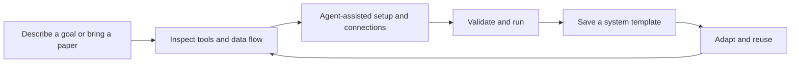
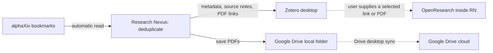

<p align="center"></p>

# Research Nexus

**Build a system that fits the way you work.**

[简体中文](README.zh-CN.md) · [Vision](#why-were-building-rn) · [Join us](#build-this-with-us) · [Windows preview v0.7.2](https://github.com/shwhwhwh/research-nexus/releases/tag/v0.7.2) · [Ownership](OWNERSHIP.md)

Research Nexus (RN) is an early-stage project working toward a simple goal: **help people turn the tools they already use into a system that feels their own.** Describe what you want to accomplish, bring your tools and data, and build a workflow you can understand, run, and improve with an agent's help.

**Research is our starting point. The long-term vision extends to learning, creative work, and other personal workflows. General-purpose, arbitrary-system construction is a goal, not a capability the current preview already delivers.**

## Why we're building RN

Useful work often happens between applications: a paper becomes a note, a note informs an experiment, and a result needs to find its way back into a project. People spend hours copying information, installing dependencies, reconnecting tools, and rebuilding workflows someone else has already figured out.

We want that effort to accumulate. When one person gets a useful system working, another person should be able to understand it, adapt it to their own setup, and keep using it.

> Having software that fits the way you work should be within everyone's reach.

The experience we are working toward is:



*This diagram describes the target experience. Support for tools, environments, validation, and adaptation is still being developed.*

A system template should preserve the hard-won setup knowledge: components, dependencies, data contracts, connections, and checks. Its next user should supply their own accounts and data, then reuse what has already been validated instead of asking an agent to redesign everything.

The agent helps implement and adapt connections. RN's intended role is the designer and controller: make the system visible, coordinate execution, explain inputs and outputs, and preserve evidence of what actually happened. Improvements should be inspectable, versioned, and tested.

## Research first, a broader goal

Research gives us concrete problems to solve: connecting literature and notes, preparing scientific software, moving data between tools, checking results, and handing a working setup to another researcher.

| Stage | Scope |
| --- | --- |
| Published preview | The literature system template and Beta agent-assisted builds using supported component recipes and declarative operations. |
| Active development | Richer workflow guides, reusable scientific systems, clearer execution evidence, and validation across user environments. |
| Long-term vision | Let people build and maintain systems for many kinds of work, with a choice of tools and agents. |

RN's progress needs to be measured by whether another person can get a system working: setup success, manual intervention, time, model usage, result correctness, and maintenance effort. A generated graph or a successful run on one developer's machine is only a first step.

## Related work and what we want to learn

RN shares substantial ground with existing projects. We want to learn from their work and explore integrations where useful.

| Project | Relevant work |
| --- | --- |
| [Paper2Agent](https://github.com/jmiao24/Paper2Agent) · [paper](https://arxiv.org/abs/2509.06917) | Turning papers and associated code into tested, callable scientific tools. |
| [n8n Assistant](https://blog.n8n.io/introducing-n8n-assistant/) | Building and refining visible, editable workflows from natural-language requests. |
| [ToolUniverse](https://github.com/mims-harvard/ToolUniverse) | Scientific tool discovery, standardized invocation, and composition. |
| [Galaxy Workflow Library](https://iwc.galaxyproject.org/about/) | Sharing documented, tested, and maintained scientific workflows. |
| [Nextflow](https://docs.seqera.io/nextflow/) | Portable computational workflows, dependency management, and reproducible execution. |
| [OpenResearch](https://github.com/alphaXiv/OpenResearch) | A local workspace and harness for research agents; also a tool connected by RN's first template. |

The question we want to explore is how these ideas can help people assemble **a personal system spanning local applications, websites, APIs, agents, and data**, then hand it to someone else with understandable setup steps and verifiable results. These are design goals to validate; this comparison is not a claim of novelty, feature exclusivity, or endorsement. Listed projects retain their own authorship and licenses.

## Build this with us

If you have ever thought, “I know how I want to work; I wish my tools could work together that way,” we would like to build this with you.

You can help by:

- **Bringing a real workflow:** describe the tools you use, where information gets stuck, and what success would look like.
- **Trying a template on a fresh setup:** report installation problems, manual fixes, and whether the result matches the promised output.
- **Improving connectors and validation:** contribute a small, documented adapter with fictional test data and clear failure handling.
- **Making systems easier to understand:** help with interaction design, accessibility, translation, and explanations of data flow.

Start with an [issue](https://github.com/shwhwhwh/research-nexus/issues/new) or read the [contribution guide](CONTRIBUTING.md). You do not need a finished implementation to share a use case. For code contributions, please read the [contribution terms](CONTRIBUTOR_AGREEMENT.md); contributors retain authorship. Please use fictional or properly shareable examples and keep credentials and private workspaces out of submissions.

**The aim is for a working system built by one person to become a starting point for the next.**

## What is available today

Research Nexus currently provides a local research workspace and top-level controller. Its first **System Template** connects alphaXiv, Zotero, OpenResearch, and a Google Drive desktop folder. Install the template, connect your own accounts and installed tools, then use the existing system inside RN.

**v0.7 adds automatic system builds (Beta).** Submit a paper or describe a workflow; your local Codex/Claude designs a reusable blueprint, RN prepares supported components and tests/deploys its compiled channels. Export/import replays those channels without redesigning with an agent. [Automatic build guide](docs/AUTO_BUILD.md) · [中文](docs/AUTO_BUILD.zh-CN.md). Event-driven OpenResearch project onboarding, daily citation delivery, and orbital/structured graph layouts remain available. Unsupported APIs/adapters stay explicit setup requirements. The v0.7.2 source kit contains the current build and licensing documents. The historical demo below shows Template 01; it does not demonstrate the automatic builder.

Created and maintained by **[Rui Li (@shwhwhwh)](https://github.com/shwhwhwh)**. Copyright © 2026 Rui Li. **All owner-controlled code in this official distribution, including earlier self-owned code, is offered under [LICENSE](LICENSE) 1.1: all rights reserved, with free personal study and noncommercial experiments. Commercialization requires separate written authorization.**
Collaboration is welcome: [contribution terms](CONTRIBUTOR_AGREEMENT.md) · [commercial inquiry](COMMERCIAL_LICENSE.md) · [historical grants](LICENSE_HISTORY.md).
**Valid historical RN MIT grants remain effective within their original scope, including commercial rights. The current official offer covers all owner-controlled code; it does not revoke earlier grants or relicense third-party work.**

## System Template 01 — Literature Research System

[Download the template](https://github.com/shwhwhwh/research-nexus/releases/download/v0.7.2/literature-workspace.rn-system.json) · [View its contents](system-templates/literature-workspace.rn-system.json)



RN performs literature import and deduplication. Zotero handles its own metadata sync, and Google Drive for desktop handles PDF file sync. OpenResearch opens as an installed local application inside RN; the user chooses a paper and supplies its link or PDF to a research conversation. Automatic Zotero-to-OpenResearch data transfer is not implemented.

No connector generation, canvas editing, or Codex/Claude Code call is needed to use this template. Your agent/model login is configured inside OpenResearch if you use its research features.

## Demo

[](https://github.com/shwhwhwh/research-nexus/releases/tag/v0.7.2)

[Watch / download the system demo](https://heathcliffak.com/assets/prototypes/research-nexus-system-demo.mp4) · [Demo details](docs/DEMO.md)

The demo records RN itself with an isolated profile, fictional papers, simulated external services, and no real accounts. It runs RN's actual archive engine, writes two local PDFs, and verifies that a repeat run creates no duplicates. Third-party application views are explicitly labeled illustrations; the video does not show anyone's real library or conversations.

## Install RN (Windows source preview)

Current distribution: **Windows x64 source preview**, requiring Windows 10/11, Node.js 22.12+ with npm, Python 3.10+ with pip, and Git. There is no signed desktop installer yet. Install RN once before importing a system template.

Download [research-nexus-v0.7.2-windows-source.zip](https://github.com/shwhwhwh/research-nexus/releases/download/v0.7.2/research-nexus-v0.7.2-windows-source.zip), compare it with `SHA256SUMS.txt`, and extract into a new writable folder such as `$HOME\Apps\RN-0.7.1`. Open its `research-nexus` subfolder.

```powershell
Set-Location "$HOME\Apps\RN-0.7.1\research-nexus"
powershell -NoProfile -ExecutionPolicy Bypass -File scripts/setup.ps1
npm start
```

For another Python location, add `-Python "C:\path\to\python.exe"` to the setup command. Setup installs dependencies, writes ignored machine-specific runtime settings, and compiles the native window host. Use a writable folder. After setup, double-click **Start Research Nexus.vbs** or **Start System Templates.vbs**; optional desktop shortcuts are created with `desktop/install-nexus-shortcuts.ps1`.

See [INSTALL.md](INSTALL.md) for installation, upgrade and licensing details. Older release downloads are withdrawn; earlier permissions remain unchanged.

## Download a template and run your system

1. Download `literature-workspace.rn-system.json`. In RN, open **系统模板** (System Templates) → **导入下载的模板** (Import downloaded template). The same reviewed template is also available through **安装此模板** (Install template).
2. In **首次配置** (First-time setup), provide your own alphaXiv API Key, Zotero API Key, and Zotero numeric User ID. The Zotero key needs personal-library read and write access, including notes. Keys are saved locally and are never included in the template.
3. Install [Zotero](https://www.zotero.org/download/) and [OpenResearch](https://github.com/alphaXiv/OpenResearch#readme), then choose their `.exe` paths. Sign in to the matching Zotero account and enable its automatic metadata sync. OpenResearch's Windows build requires [Git for Windows](https://git-scm.com/downloads/win); complete your own agent login in OpenResearch.
4. Install and sign in to [Google Drive for desktop](https://support.google.com/drive/answer/10838124). Create a PDF folder inside its synchronized drive, select it in RN, and confirm the login/sync steps. RN does not perform Google OAuth itself.
5. Choose **保存配置** (Save), **检查 API 连接** (Check API connections), then **启用系统 · 每天检查** (Enable system: daily checks). Use **立即归档** (Archive now) for a first manual run.
6. Use RN's tool sidebar to discover papers in alphaXiv, read/cite in the installed Zotero window, and continue research in the installed OpenResearch window.

Importing the same template again is safe and preserves existing accounts and schedules. Saving the setup form pauses automatic archiving; check the connections and re-enable when ready. Template import itself does not write literature or turn on a schedule.

Detailed guide: [English](docs/SYSTEM_TEMPLATE.md) · [中文](docs/SYSTEM_TEMPLATE.zh-CN.md).

## Behavior and limits

- Automatic archive currently covers public arXiv papers returned by alphaXiv. Stable paper identifiers are used for deduplication; ambiguous matches require review.
- PDFs are linked files in a user-selected Drive folder. They are mainly used in Zotero desktop; they do not become Zotero web/mobile PDF attachments. See [Zotero linked-file documentation](https://www.zotero.org/support/attaching_files#linked_files).
- Zotero's metadata sync and Drive's file sync remain separate. Only PDFs go into the shared folder; keep the Zotero database in its own local data directory.
- API checks verify reading. The first actual archive validates the required write permissions. Drive / local-agent login confirmations are user acknowledgments, not automatic account verification.
- Closing RN hides it to the tray. Schedules run while RN is running and the computer is awake. Quit from RN's tray menu. Other apps' background behavior depends on their own setup.
- Credentials, browser profiles, literature, and runtime files are under ignored `data/`. Saved keys use Windows DPAPI. Never upload this directory.
- Downloaded templates are data files, not executable plugins. This version accepts only the exact bundled reviewed template and rejects modified/unrecognized manifests.

## Development

```powershell
npm run check
npm test
npm run test:desktop
npm run test:systems
npm run test:alpha
```

Tests use isolated fixture storage. The system UI test downloads/imports the template, completes dummy setup, archives two fictional papers with the real engine, checks repeat deduplication, and verifies that the DIY canvas is available while malformed requests are rejected. No real accounts or tools are opened. Optional [CI template](docs/ci/check.yml) requires repository workflow permission to enable.

Desktop lifecycle tests cover delayed/failed native detach and repeated quit requests. RN waits for the native host to verify that external windows have been restored before it exits; a failed detach keeps RN running for a retry. For an opt-in check with your installed applications, start RN with `--verify-native-tools` (add `--quit-after-native-check` for an exit/reopen check). This opens the real application windows and records only window identity and geometry under ignored `data/`, without capturing their content.

[Roadmap](docs/ROADMAP.md) · [Architecture](docs/architecture.md) · [Contributing](CONTRIBUTING.md) · [Security](SECURITY.md) · [Third-party notices](THIRD_PARTY_NOTICES.md)

Typography and spacing are inspired by the Codex desktop design. The original soft-gradient ribbon icon takes color direction from Antigravity. No third-party application code, font files, logos, or personal reference artwork are included.
