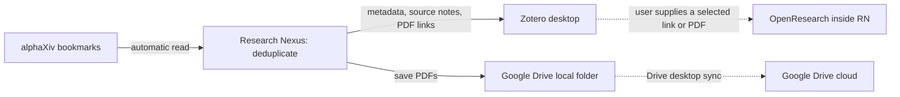

<p align="center"></p>

# Research Nexus

**One workspace. A ready-made research system.**

[简体中文](README.zh-CN.md) · [Download v0.3.0](https://github.com/shwhwhwh/research-nexus/releases/tag/v0.3.0) · [Template guide](docs/SYSTEM_TEMPLATE.md) · [Ownership](OWNERSHIP.md)

Research Nexus (RN) is a local research workspace and top-level controller. Its first **System Template** connects alphaXiv, Zotero, OpenResearch, and a Google Drive desktop folder. Install the template, connect your own accounts and installed tools, then use the existing system inside RN.

**DIY data-flow building and agent-driven self-evolution are unfinished.** They are marked as under development in the app and are not available in this release. The earlier experimental designer is retained internally for development; its execution APIs and scheduler are disabled.

Created and maintained by **[Rui Li (@shwhwhwh)](https://github.com/shwhwhwh)**. Copyright © 2026 Rui Li. [MIT License](LICENSE); retain its copyright and permission notice when redistributing.

## System Template 01 — Literature Research System

[Download the template](https://github.com/shwhwhwh/research-nexus/releases/download/v0.3.0/literature-workspace.rn-system.json) · [View its contents](system-templates/literature-workspace.rn-system.json)



RN performs literature import and deduplication. Zotero handles its own metadata sync, and Google Drive for desktop handles PDF file sync. OpenResearch opens as an installed local application inside RN; the user chooses a paper and supplies its link or PDF to a research conversation. Automatic Zotero-to-OpenResearch data transfer is not implemented.

No connector generation, canvas editing, or Codex/Claude Code call is needed to use this template. Your agent/model login is configured inside OpenResearch if you use its research features.

## Demo

[](https://github.com/shwhwhwh/research-nexus/releases/tag/v0.3.0)

[Watch / download the system demo](https://github.com/shwhwhwh/research-nexus/releases/download/v0.3.0/research-nexus-system-demo.mp4) · [Demo details](docs/DEMO.md)

The demo records RN itself with an isolated profile, fictional papers, simulated external services, and no real accounts. It runs RN's actual archive engine, writes two local PDFs, and verifies that a repeat run creates no duplicates. Third-party application views are explicitly labeled illustrations; the video does not show anyone's real library or conversations.

## Install RN (Windows source preview)

Current distribution: **Windows x64 source preview**, requiring Windows 10/11, Node.js 22.12+ with npm, Python 3.10+ with pip, and Git. There is no signed desktop installer yet. Install RN once before importing a system template.

```powershell
git clone https://github.com/shwhwhwh/research-nexus.git
cd research-nexus
powershell -NoProfile -ExecutionPolicy Bypass -File scripts/setup.ps1
npm start
```

For another Python location, add `-Python "C:\path\to\python.exe"` to the setup command. Setup installs dependencies, writes ignored machine-specific runtime settings, and compiles the native window host. Use a writable folder. After setup, double-click **Start Research Nexus.vbs** or **Start System Templates.vbs**; optional desktop shortcuts are created with `desktop/install-nexus-shortcuts.ps1`.

## Download a template and run your system

1. Download `literature-workspace.rn-system.json`. In RN, open **系统模板** (System Templates) → **导入下载的模板** (Import downloaded template). The same reviewed template is also available through **安装此模板** (Install template).
2. In **首次配置** (First-time setup), provide your own alphaXiv API Key, Zotero API Key, and Zotero numeric User ID. The Zotero key needs personal-library read and write access, including notes. Keys are saved locally and are never included in the template.
3. Install [Zotero](https://www.zotero.org/download/) and [OpenResearch](https://github.com/alphaXiv/OpenResearch#readme), then choose their `.exe` paths. Sign in to the matching Zotero account and enable its automatic metadata sync. OpenResearch's Windows build requires [Git for Windows](https://git-scm.com/downloads/win); complete your own agent login in OpenResearch.
4. Install and sign in to [Google Drive for desktop](https://support.google.com/drive/answer/10838124). Create a PDF folder inside its synchronized drive, select it in RN, and confirm the login/sync steps. RN does not perform Google OAuth itself.
5. Choose **保存配置** (Save), **检查 API 连接** (Check API connections), then **启用系统 · 每天检查** (Enable system: daily checks). Use **立即归档** (Archive now) for a first manual run.
6. Use RN's tool sidebar to discover papers in alphaXiv, read/cite in the installed Zotero window, and continue research in the installed OpenResearch window.

Importing the same template again is safe and preserves existing accounts and schedules. Saving the setup form pauses automatic archiving; check the connections and re-enable when ready. Template import itself does not write literature or turn on a schedule.

Detailed guide: [English](docs/SYSTEM_TEMPLATE.md) · [中文](docs/SYSTEM_TEMPLATE.zh-CN.md).

## Behavior and limits

- Automatic archive currently covers public arXiv papers returned by alphaXiv. Stable paper identifiers are used for deduplication; ambiguous matches require review.
- PDFs are linked files in a user-selected Drive folder. They are mainly used in Zotero desktop; they do not become Zotero web/mobile PDF attachments. See [Zotero linked-file documentation](https://www.zotero.org/support/attaching_files#linked_files).
- Zotero's metadata sync and Drive's file sync remain separate. Only PDFs go into the shared folder; keep the Zotero database in its own local data directory.
- API checks verify reading. The first actual archive validates the required write permissions. Drive / local-agent login confirmations are user acknowledgments, not automatic account verification.
- Closing RN hides it to the tray. Schedules run while RN is running and the computer is awake. Quit from RN's tray menu. Other apps' background behavior depends on their own setup.
- Credentials, browser profiles, literature, and runtime files are under ignored `data/`. Saved keys use Windows DPAPI. Never upload this directory.
- Downloaded templates are data files, not executable plugins. This version accepts only the exact bundled reviewed template and rejects modified/unrecognized manifests.

## Development

```powershell
npm run check
npm test
npm run test:desktop
npm run test:systems
npm run test:alpha
```

Tests use isolated fixture storage. The system UI test downloads/imports the template, completes dummy setup, archives two fictional papers with the real engine, checks repeat deduplication, and verifies that DIY execution is disabled. No real accounts or tools are opened. Optional [CI template](docs/ci/check.yml) requires repository workflow permission to enable.

Desktop lifecycle tests cover delayed/failed native detach and repeated quit requests. RN waits for the native host to verify that external windows have been restored before it exits; a failed detach keeps RN running for a retry. For an opt-in check with your installed applications, start RN with `--verify-native-tools` (add `--quit-after-native-check` for an exit/reopen check). This opens the real application windows and records only window identity and geometry under ignored `data/`, without capturing their content.

[Roadmap](docs/ROADMAP.md) · [Architecture](docs/architecture.md) · [Contributing](CONTRIBUTING.md) · [Security](SECURITY.md) · [Third-party notices](THIRD_PARTY_NOTICES.md)

Typography and spacing are inspired by the Codex desktop design. The original soft-gradient ribbon icon takes color direction from Antigravity. No third-party application code, font files, logos, or personal reference artwork are included.
