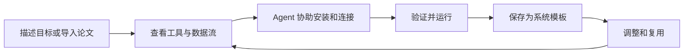
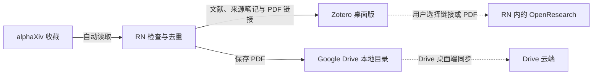

<p align="center"></p>

# Research Nexus

**让每个人都能搭建一套用起来顺手的系统。**

[English](README.md) · [项目愿景](#为什么要做-rn) · [一起搭建](#一起把它搭建出来) · [Windows 预览版 v0.7.2](https://github.com/shwhwhwh/research-nexus/releases/tag/v0.7.2) · [项目归属](OWNERSHIP.md)

Research Nexus（RN）希望帮助人们把自己使用的工具，组成一套适合自己的系统。你描述想完成的事情，带上已有的工具和数据，由 Agent 协助搭建；你可以看懂它怎样工作，运行它，再按自己的习惯逐步调整。

**科研是 RN 当前的起点。长期愿景是支持学习、创作及更多个人工作场景。“搭建任意用途的系统”是我们努力的方向，目前的预览版还没有实现这一通用能力。**

## 为什么要做 RN

很多工作发生在软件之间：读到一篇论文，记下一段笔记，形成一个实验，再把结果放回项目。为了让工具配合，我们反复复制信息、安装依赖、配置接口，也反复踩别人已经踩过的坑。

我们希望这些努力能够积累下来。一个人花时间调通的系统，下一个人可以看懂、导入、调整，然后真正用起来。

> 拥有一套适合自己的软件系统，应该成为每个人都能获得的能力。

我们希望逐步实现这样的体验：



*这张图表达目标体验；工具支持、环境适配、验证和持续调整仍在建设中。*

系统模板应当保存那些真正费时间的经验：用了哪些组件、需要什么依赖、数据怎样衔接、怎样检查是否正确。下一个用户提供自己的账号与数据后，应尽可能复用已验证的部分，减少让 Agent 从头设计和重复排错的成本。

Agent 帮助实现和适配连接。RN 希望承担设计器与顶层控制器的角色：把系统展示清楚，协调执行，解释输入输出，保留实际运行证据。系统的改进应当有可检查的变化、版本记录和测试。

## 从科研出发，走向更多用途

科研让我们能够从具体问题做起：连接文献与笔记、准备科学计算工具、打通数据、验证结果，再把一套能运行的系统交给另一个研究者。

| 阶段 | 范围 |
| --- | --- |
| 已发布预览版 | 文献系统模板，以及基于受支持组件配方和声明式操作的 Agent 辅助自动构建 Beta。 |
| 正在开发 | 更完整的流程导览、可复用科研系统、更清楚的执行证据，以及不同用户环境下的验证。 |
| 长期愿景 | 让用户选择自己的工具和 Agent，为多种用途搭建、维护适合自己的系统。 |

RN 的进展要由实际使用来验证：另一个人能否装起来、需要多少人工干预、花费多少时间与模型额度、结果是否正确，以及之后维护是否容易。生成一张图、在开发者的电脑上跑通一次，只是第一步。

## 相关工作与我们希望学习的方向

RN 与许多已有项目有重合。我们希望认真学习这些工作，并在适合的地方探索连接和复用。

| 项目 | 与 RN 相关的工作 |
| --- | --- |
| [Paper2Agent](https://github.com/jmiao24/Paper2Agent) · [论文](https://arxiv.org/abs/2509.06917) | 将论文及相关代码转化为经过测试、可调用的科研工具。 |
| [n8n Assistant](https://blog.n8n.io/introducing-n8n-assistant/) | 根据自然语言需求搭建和调整可视、可编辑的工作流。 |
| [ToolUniverse](https://github.com/mims-harvard/ToolUniverse) | 科学工具的发现、统一调用和组合。 |
| [Galaxy Workflow Library](https://iwc.galaxyproject.org/about/) | 分享带说明、测试和持续维护的科研工作流。 |
| [Nextflow](https://docs.seqera.io/nextflow/) | 可迁移计算流程、依赖管理与可复现执行。 |
| [OpenResearch](https://github.com/alphaXiv/OpenResearch) | 本地科研 Agent 工作台与 Harness，也是 RN 首个模板连接的工具之一。 |

我们希望探索的是：怎样帮助用户把本地应用、网页、API、Agent 和数据组成自己的系统，再带着清楚的配置说明和可验证的结果，把它交给另一个人。这些是需要验证的设计目标；上表不构成首创性、功能独占或官方背书的声明。各项目保留各自的作者归属与许可。

## 一起把它搭建出来

如果你也曾想过：“我知道自己想怎么工作，只是希望这些工具能按这个方式配合起来。”欢迎一起做 RN。

可以从一件具体的事参与：

- **带来一个真实流程：** 说说你使用哪些工具、信息卡在哪里，以及什么结果才算成功。
- **在新环境里试用模板：** 记录安装失败、人工修正，以及实际输出是否符合说明。
- **完善连接器与验证：** 提交一个小而清楚的适配器，附上虚构测试数据与失败处理方式。
- **让系统更容易理解：** 参与交互设计、无障碍、翻译，以及数据流与工具说明。

你可以先[开一个 Issue](https://github.com/shwhwhwh/research-nexus/issues/new)，或阅读[贡献指南](CONTRIBUTING.md)。分享使用场景不需要先写好代码；提交代码前请阅读[贡献条款](CONTRIBUTOR_AGREEMENT.md)，贡献者保留署名。请使用虚构或有权分享的样例，不要提交账号密钥、私人数据或工作空间截图。

**希望一个人搭好的系统，能够成为下一个人的起点。**

## 当前可以使用什么

Research Nexus 目前提供本地科研工作台与顶层控制器。第一个 **System Template（系统模板）** 已经连接 alphaXiv、Zotero、OpenResearch 及 Google Drive 同步目录。用户安装模板后，只需配置自己的账号授权、本地软件与同步文件夹，即可在 RN 中使用这套系统。

**v0.7 新增自动构建系统（Beta）。** 输入论文或文字需求，由本机 Codex / Claude 设计可复用 Blueprint，RN 准备受支持组件并测试、部署已编译通道。导出模板后，其他用户可导入复用，无需重新调用 Agent 从头设计。参见 [自动构建指南](docs/AUTO_BUILD.zh-CN.md) / [English](docs/AUTO_BUILD.md)。保留项目事件即时接入、每日引用同步及轨道 / 规整画布。未知接口与适配器明确列为待办。v0.7.2 源码包包含当前功能与完整许可文件；下方历史视频只展示 Template 01，不代表自动构建器演示。

**由 [Rui Li（@shwhwhwh）](https://github.com/shwhwhwh) 创建和维护，版权所有 © 2026 Rui Li。** 今后官方发行中的全部自有代码（包括此前自有代码，不只新增部分）统一按许可 1.1 提供，保留全部权利；[个人学习、非商业试验及协作改进可免费进行](LICENSE)，商业化需[单独书面授权](COMMERCIAL_LICENSE.md)。欢迎提交 Issue 和 PR，贡献者保留署名并按[贡献条款](CONTRIBUTOR_AGREEMENT.md)授权项目维护与商业发布。**既有有效 MIT 授权在原有范围内继续有效，包括其商业权限；本次不撤回旧授权、不追溯收费，也不改变第三方许可。** 参见[许可沿革](LICENSE_HISTORY.md)。第三方工具归各自权利人所有。

## System Template 01：文献科研系统

[下载模板文件](https://github.com/shwhwhwh/research-nexus/releases/download/v0.7.2/literature-workspace.rn-system.json) · [查看模板内容](system-templates/literature-workspace.rn-system.json)



RN 负责收藏读取、去重和归档；Zotero 自己同步文献元数据，Google Drive 桌面端同步 PDF 文件。OpenResearch 使用 RN 中的本地应用窗口，用户把选中的论文链接或 PDF 提供给研究对话。当前尚未实现 Zotero 到 OpenResearch 的自动数据传递。

使用这个模板不需要画数据流、不需要生成连接器，也不需要 RN 调用 Codex / Claude Code。需要 OpenResearch 的研究功能时，在 OpenResearch 内完成自己的 Agent / 模型授权。

## 使用演示

[](https://github.com/shwhwhwh/research-nexus/releases/tag/v0.7.2)

[观看 / 下载系统演示视频](https://heathcliffak.com/assets/prototypes/research-nexus-system-demo.mp4) · [演示说明](docs/DEMO.md)

视频只演示这个系统模板：独立 RN、虚构论文和模拟外部服务。实际运行 RN 的归档引擎，写入两个本地 PDF，并验证重复运行没有重复导入。第三方工具页面明确标为示意界面，不出现个人账号、真实文献库或研究对话。

## 安装 RN（Windows 源码预览版）

当前为 **Windows x64 源码预览版**，尚无签名安装包。安装 RN 需要 Windows 10/11、Node.js 22.12+（含 npm）、Python 3.10+（含 pip）及 Git。完成 RN 的一次安装后，再导入系统模板。

下载 [research-nexus-v0.7.2-windows-source.zip](https://github.com/shwhwhwh/research-nexus/releases/download/v0.7.2/research-nexus-v0.7.2-windows-source.zip)，与同页 `SHA256SUMS.txt` 核对后，解压到可写的新目录（例如 `$HOME\Apps\RN-0.7.1`），进入其中的 `research-nexus` 文件夹。

```powershell
Set-Location "$HOME\Apps\RN-0.7.1\research-nexus"
powershell -NoProfile -ExecutionPolicy Bypass -File scripts/setup.ps1
npm start
```

若 Python 不在默认位置，在安装命令后添加 `-Python "C:\path\to\python.exe"`。脚本安装依赖并编译窗口组件。请选择可写目录。安装后双击 **Start Research Nexus.vbs** 或 **Start System Templates.vbs**；也可运行 `desktop/install-nexus-shortcuts.ps1` 创建快捷方式。

完整安装、升级与许可说明见 [INSTALL.md](INSTALL.md)。旧发布包已撤下公开下载入口；原有授权保持不变。

## 下载模板后如何运行

1. 下载 `literature-workspace.rn-system.json`，在 RN 左侧打开 **系统模板 → 导入下载的模板**。也可直接安装 RN 内置的同一份模板。
2. 在 **首次配置** 中填写自己的 alphaXiv API Key、Zotero API Key 和 Zotero 数字 User ID。Zotero Key 需要个人库读写及笔记访问权限。密钥只保存到本机。
3. 安装 [Zotero](https://www.zotero.org/download/) 和 [OpenResearch](https://github.com/alphaXiv/OpenResearch#readme)，选择其 `.exe` 路径；在 Zotero 登录与 Key 对应的账号并开启自动同步。OpenResearch Windows 版需要 [Git for Windows](https://git-scm.com/downloads/win)，其 Agent 登录在软件内完成。
4. 安装并登录 [Google Drive 桌面端](https://support.google.com/drive/answer/10838124)，在其同步空间中创建 PDF 文件夹，在 RN 中选择该文件夹并确认已登录。Google 登录由 Drive 客户端负责。
5. 点击 **保存配置 → 检查 API 连接 → 启用系统 · 每天检查**。首次可点击 **立即归档** 手动测试。
6. 在 RN 侧边栏使用 alphaXiv 收藏和阅读，在本机 Zotero 窗口整理与引用，在本机 OpenResearch 窗口继续研究。

重复导入同一个模板会保留现有账号、文献和归档频率。保存首次配置会暂停自动归档，检查连接后重新启用。导入模板本身不会写入文献或自动开启定时任务。

## 当前边界

- 自动归档当前支持 alphaXiv 返回的公开 arXiv 论文，使用稳定论文编号去重，疑似重复需要人工核对。
- Drive 同步的 PDF 为 Zotero 链接文件，主要在桌面使用，不会因此成为 Zotero 网页或手机端附件。参见 [Zotero 官方说明](https://www.zotero.org/support/attaching_files#linked_files)。
- Zotero 元数据同步与 Drive 文件同步分别由相应客户端完成；同步目录只放 PDF，Zotero 数据库保留在其本地目录。
- API 连接检查验证读取权限；首次归档验证写入权限。Drive、Zotero 同步及 Agent 登录状态由用户确认。
- 关闭 RN 窗口会隐藏至托盘，在托盘中选择退出才结束；定时任务需要 RN 运行且电脑唤醒。其他软件的后台行为取决于各自配置。
- 账号、浏览器登录状态、文献及运行数据位于被忽略的 `data/`，密钥由 Windows DPAPI 保护，请勿上传此目录。
- 模板是配置描述，不执行下载来的代码；当前只接收内置、已核对的模板版本，修改或未知模板会被拒绝。

## 开发和后续方向

```powershell
npm run check
npm test
npm run test:desktop
npm run test:systems
npm run test:alpha
```

模板界面测试使用独立数据，验证导出导入、首次配置、真实归档引擎、重复运行及 DIY 未开放状态，不访问真实账号。仓库保留可选 [CI 模板](docs/ci/check.yml)，启用需要 GitHub 工作流权限。

桌面生命周期测试覆盖窗口释放延迟、失败和连续退出。RN 必须收到原生组件确认窗口已安全恢复后才退出，释放失败时保持运行以便重试。需要核对本机真实窗口时，可用 `--verify-native-tools` 启动 RN；增加 `--quit-after-native-check` 可验证退出后重新打开。此检查会打开已安装的工具，仅在被忽略的 `data/` 中记录窗口身份和尺寸，不录制应用内容。

[路线图](docs/ROADMAP.md) · [架构](docs/architecture.md) · [贡献指南](CONTRIBUTING.md) · [安全说明](SECURITY.md) · [第三方组件](THIRD_PARTY_NOTICES.md)

字体与排版风格参考 Codex 桌面端；原创柔和渐变环图标的配色方向参考 Antigravity。未包含第三方应用代码、字体、标识或个人参考素材。
