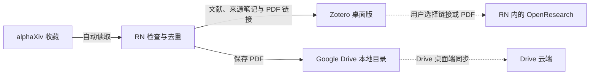
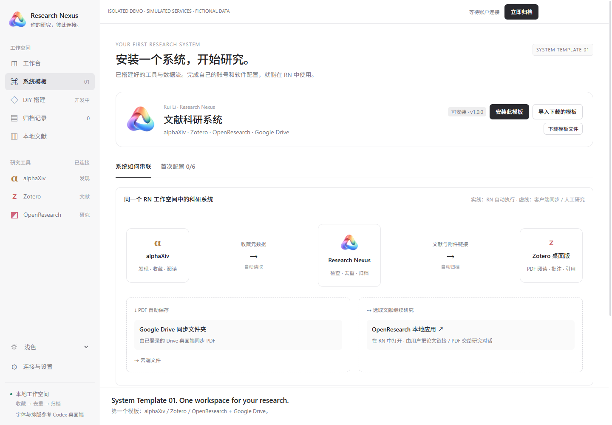

<p align="center"></p>

# Research Nexus

**一个工作空间，运行一套已经搭建好的科研系统。**

[English](README.md) · [下载 v0.3.0](https://github.com/shwhwhwh/research-nexus/releases/tag/v0.3.0) · [模板使用指南](docs/SYSTEM_TEMPLATE.zh-CN.md) · [项目归属](OWNERSHIP.md)

Research Nexus（RN）是本地科研工作台与顶层控制器。第一个 **System Template（系统模板）** 已经连接 alphaXiv、Zotero、OpenResearch 及 Google Drive 同步目录。用户安装模板后，只需配置自己的账号授权、本地软件与同步文件夹，即可在 RN 中使用这套系统。

**v0.4 源码版已开放 DIY 设计器（Beta）。** 画线后由本地 Codex / Claude Code 生成版本，预览、启用并运行。新增 OpenResearch 项目引用流：alphaXiv 分类收藏，Zotero 保存引用正文与出处笔记。参见 [中文指南](docs/DIY.zh-CN.md) / [English](docs/DIY.md)。Agent 修订版仍需用户核对和启用，不会自主替换。下方 v0.3.0 下载与演示视频展示原 System Template 01。

**由 [Rui Li（@shwhwhwh）](https://github.com/shwhwhwh) 创建和维护，版权所有 © 2026 Rui Li。** 原创代码、文档和项目图标采用 [MIT 许可证](LICENSE)，复制与分发时须保留版权及许可声明。第三方工具归各自权利人所有。

## System Template 01：文献科研系统

[下载模板文件](https://github.com/shwhwhwh/research-nexus/releases/download/v0.3.0/literature-workspace.rn-system.json) · [查看模板内容](system-templates/literature-workspace.rn-system.json)



RN 负责收藏读取、去重和归档；Zotero 自己同步文献元数据，Google Drive 桌面端同步 PDF 文件。OpenResearch 使用 RN 中的本地应用窗口，用户把选中的论文链接或 PDF 提供给研究对话。当前尚未实现 Zotero 到 OpenResearch 的自动数据传递。

使用这个模板不需要画数据流、不需要生成连接器，也不需要 RN 调用 Codex / Claude Code。需要 OpenResearch 的研究功能时，在 OpenResearch 内完成自己的 Agent / 模型授权。

## 使用演示

[](https://github.com/shwhwhwh/research-nexus/releases/tag/v0.3.0)

[观看 / 下载系统演示视频](https://github.com/shwhwhwh/research-nexus/releases/download/v0.3.0/research-nexus-system-demo.mp4) · [演示说明](docs/DEMO.md)

视频只演示这个系统模板：独立 RN、虚构论文和模拟外部服务。实际运行 RN 的归档引擎，写入两个本地 PDF，并验证重复运行没有重复导入。第三方工具页面明确标为示意界面，不出现个人账号、真实文献库或研究对话。

## 安装 RN（Windows 源码预览版）

当前为 **Windows x64 源码预览版**，尚无签名安装包。安装 RN 需要 Windows 10/11、Node.js 22.12+（含 npm）、Python 3.10+（含 pip）及 Git。完成 RN 的一次安装后，再导入系统模板。

```powershell
git clone https://github.com/shwhwhwh/research-nexus.git
cd research-nexus
powershell -NoProfile -ExecutionPolicy Bypass -File scripts/setup.ps1
npm start
```

若 Python 不在默认位置，在安装命令后添加 `-Python "C:\path\to\python.exe"`。脚本安装依赖并编译窗口组件。请选择可写目录。安装后双击 **Start Research Nexus.vbs** 或 **Start System Templates.vbs**；也可运行 `desktop/install-nexus-shortcuts.ps1` 创建快捷方式。

## 下载模板后如何运行

1. 下载 `literature-workspace.rn-system.json`，在 RN 左侧打开 **系统模板 → 导入下载的模板**。也可直接安装 RN 内置的同一份模板。
2. 在 **首次配置** 中填写自己的 alphaXiv API Key、Zotero API Key 和 Zotero 数字 User ID。Zotero Key 需要个人库读写及笔记访问权限。密钥只保存到本机。
3. 安装 [Zotero](https://www.zotero.org/download/) 和 [OpenResearch](https://github.com/alphaXiv/OpenResearch#readme)，选择其 `.exe` 路径；在 Zotero 登录与 Key 对应的账号并开启自动同步。OpenResearch Windows 版需要 [Git for Windows](https://git-scm.com/downloads/win)，其 Agent 登录在软件内完成。
4. 安装并登录 [Google Drive 桌面端](https://support.google.com/drive/answer/10838124)，在其同步空间中创建 PDF 文件夹，在 RN 中选择该文件夹并确认已登录。Google 登录由 Drive 客户端负责。
5. 点击 **保存配置 → 检查 API 连接 → 启用系统 · 每天检查**。首次可点击 **立即归档** 手动测试。
6. 在 RN 侧边栏使用 alphaXiv 收藏和阅读，在本机 Zotero 窗口整理与引用，在本机 OpenResearch 窗口继续研究。

重复导入同一个模板会保留现有账号、文献和归档频率。保存首次配置会暂停自动归档，检查连接后重新启用。导入模板本身不会写入文献或自动开启定时任务。

## 当前边界

- 自动归档当前支持 alphaXiv 返回的公开 arXiv 论文，使用稳定论文编号去重，疑似重复需要人工核对。
- Drive 同步的 PDF 为 Zotero 链接文件，主要在桌面使用，不会因此成为 Zotero 网页或手机端附件。参见 [Zotero 官方说明](https://www.zotero.org/support/attaching_files#linked_files)。
- Zotero 元数据同步与 Drive 文件同步分别由相应客户端完成；同步目录只放 PDF，Zotero 数据库保留在其本地目录。
- API 连接检查验证读取权限；首次归档验证写入权限。Drive、Zotero 同步及 Agent 登录状态由用户确认。
- 关闭 RN 窗口会隐藏至托盘，在托盘中选择退出才结束；定时任务需要 RN 运行且电脑唤醒。其他软件的后台行为取决于各自配置。
- 账号、浏览器登录状态、文献及运行数据位于被忽略的 `data/`，密钥由 Windows DPAPI 保护，请勿上传此目录。
- 模板是配置描述，不执行下载来的代码；当前只接收内置、已核对的模板版本，修改或未知模板会被拒绝。

## 开发和后续方向

```powershell
npm run check
npm test
npm run test:desktop
npm run test:systems
npm run test:alpha
```

模板界面测试使用独立数据，验证导出导入、首次配置、真实归档引擎、重复运行及 DIY 未开放状态，不访问真实账号。仓库保留可选 [CI 模板](docs/ci/check.yml)，启用需要 GitHub 工作流权限。

桌面生命周期测试覆盖窗口释放延迟、失败和连续退出。RN 必须收到原生组件确认窗口已安全恢复后才退出，释放失败时保持运行以便重试。需要核对本机真实窗口时，可用 `--verify-native-tools` 启动 RN；增加 `--quit-after-native-check` 可验证退出后重新打开。此检查会打开已安装的工具，仅在被忽略的 `data/` 中记录窗口身份和尺寸，不录制应用内容。

[路线图](docs/ROADMAP.md) · [架构](docs/architecture.md) · [贡献指南](CONTRIBUTING.md) · [安全说明](SECURITY.md) · [第三方组件](THIRD_PARTY_NOTICES.md)

字体与排版风格参考 Codex 桌面端；原创柔和渐变环图标的配色方向参考 Antigravity。未包含第三方应用代码、字体、标识或个人参考素材。
