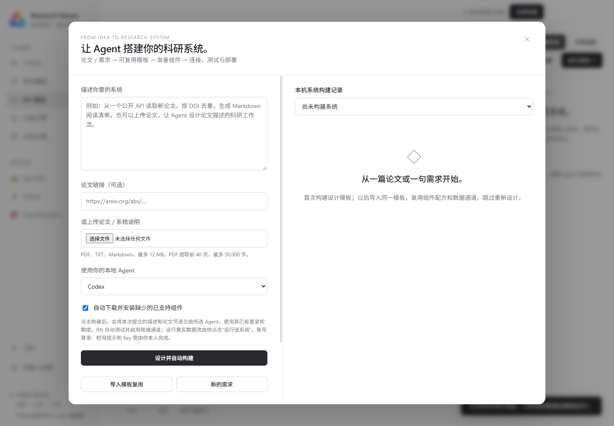

# Automatic research-system builds

RN 0.7 adds **DIY designer → Automatically build system** (自动构建系统). Describe a research workflow or provide a paper URL, PDF, TXT or Markdown file. Select a locally signed-in Codex or Claude Code and start the build.

RN designs and persists a Blueprint v2, prepares its components, binds the saved channels to this machine, starts/checks required local OpenResearch/Zotero services, runs isolated channel previews, and deploys ready integrations. **Run this system** executes the deployed channels against real APIs or supplied runtime JSON.

The first design sends only the submitted description/paper excerpts to the selected agent, using its existing login and quota. PDF input is limited to 12 MB, the first 40 pages and 50,000 extracted characters. Scanned PDFs require OCR. Paper text is untrusted source data, never permission to operate outside the requested system.

## Design once, reuse compiled channels

**Export system template** saves a `.rn-system.json` file containing component recipes, service addresses, credential variable names, flow direction, compiled plans, schedules and fictional preview inputs. It excludes credentials, consent grants, source documents, local install paths and build logs.

Import the file through the builder or System Templates page and select **Build using this template**. RN rechecks the new machine and replays the compiled channels without calling a design agent. Reimports retain stable channel/version IDs and delivery receipts; component downloads are cached. Opening the builder does not replace running systems.

Real Codex acceptance testing used one agent call for design, then re-read the exported file and deployed it with the agent disabled. Repeated runtime input produced no duplicate rows. That test used a fictional local reading-list pipeline and no personal research accounts.

## Components and setup

Recipes cover local folders, websites, HTTP APIs, alphaXiv, Zotero, OpenResearch, Google Drive, Obsidian, Python, Node.js and Git. Existing installations are reused without upgrades. Reviewed WinGet recipes use fixed package IDs, cache download hashes/versions and install that version. Missing OpenResearch uses the official Windows CLI bundle, its published SHA-256 and an RN-managed console-free `orx app` launcher. Existing installations are preserved.

Users complete OS permission prompts, sign-ins, API keys and Drive folder selection. The builder lists missing setup and supports **Continue build**, reusing the saved template and downloaded resources. Builtin accounts use **Connections and settings**. Other `NEXUS_`/`RN_` API variables can be entered in the builder; Windows DPAPI encrypts them locally, binds them to service origins and excludes them from agent prompts and exports.

Portable templates cannot grant model access or carry fixed private OpenResearch project IDs. The [project-literature blueprint](../system-templates/project-literature.rn-system.json) uses keyword classification for current/future project citations → alphaXiv folders and Zotero provenance notes/linked PDFs. Bookmark archiving remains the separately installed Template 01. The file is imported deliberately and never adds demo nodes at startup.

## Execution boundaries

The builder supports RN's implemented declarative operations: HTTP requests, field selection/mapping, filtering, deduplication, JSON/Markdown output and builtin literature connectors. Missing APIs, arbitrary training scripts, unknown installation recipes and unimplemented adapters remain explicit setup requirements; sample staging is never called a live integration.

Previews make no external requests or account writes. **Run this system** performs real execution. Folder sources accept optional runtime JSON; leaving it empty uses the template sample. HTTP sources fetch the real service. Whole-system execution supports DAGs, branching and one incoming channel per target; joins and feedback loops require additional implementation. Existing manual graph editing and per-edge generation remain available.

The [Blueprint v2 JSON schema](../system-templates/blueprint-v2.schema.json) contains data, never shell commands, executable plugins or local program paths. Installation commands live in RN's reviewed recipes.

Run `npm test` for isolated unit/HTTP tests and `npm run test:systems` for desktop import/build/run checks. The opt-in `python scripts/verify-system-builder.py --live-agent --provider codex` invokes a real local agent with fictional data and isolated storage; it consumes that account's quota.
