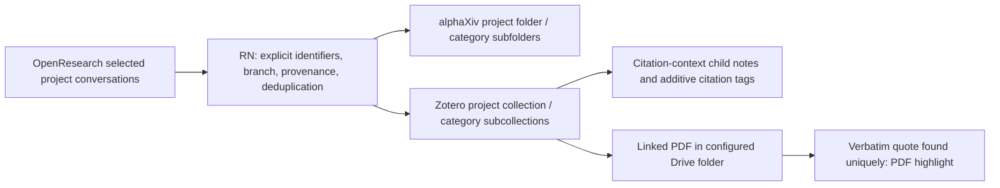

# DIY research systems (Beta)

[中文](DIY.zh-CN.md)

The designer is now available in the current source build. Template 01 remains available independently. Agent-generated plans are versioned declarations executed by RN's supported operations; they are not arbitrary generated programs.

1. Open **DIY 搭建**. Add websites, API services, installed applications, or managed output folders. Drag an output port to an input port and describe the flow.
2. Register each service's API origin and credential environment-variable names. The designer never accepts API keys inside a plan. Your existing alphaXiv/Zotero keys stay in RN's protected configuration.
3. Ask your installed, signed-in Codex CLI or Claude Code to generate a version. Review the steps and requirements, run the sample preview, then activate that exact version.
4. Run the edge or the enabled graph. Manual, hourly, and daily schedules are available. Changing the source, destination, purpose, sample, or project scope invalidates the prior activation. You can test and switch back to an earlier version whose contract still matches.
5. If a run fails, use the repair action to generate a candidate revision. A revision requires testing and activation; RN never promotes it automatically.

## OpenResearch project citations

Choose **连接项目文献**, select projects, choose a per-run paper limit, and edit category names/keywords. This creates two scoped drafts:

Preview the real source read-only, then generate, sample-test, activate, and run each draft. The current alphaXiv MCP exposes folder/bookmark writes and annotation/note reads, but no supported note/highlight writer. RN therefore keeps discovery/classification in alphaXiv and writes detailed project citation context into Zotero. It does not post public comments or use private browser endpoints as a substitute.

The source reads OpenResearch's local project/session/message APIs. Busy sessions are deferred; only the selected message branch is exported. Legacy idle messages without a completion timestamp retain their existing text with unknown completion metadata. Reasoning parts, shell/tool inputs, unfinished tool results, and abandoned branches are excluded. Optionally include completed tool outputs, explicitly labelled as discovery rather than a verified paper quotation.

Explicit arXiv and DOI references are supported. Title-only mentions are not guessed. Non-arXiv papers can go to Zotero when Crossref verifies their DOI metadata. Choose local keyword rules or Codex/Claude semantic classification. Semantic classification sends only the selected project citation excerpts to the signed-in model service, after explicit consent bound to that provider and project set. Changing a fixed project set or provider requires new consent. The explicit future-project mode below covers newly discovered project IDs without changing its tested contract. Decisions are validated against permitted categories and citation IDs, then cached across both edges and restarts. Uncertain context goes to **待分类**. Plan generation uses the declared purpose and sample. Compiler/classifier calls disable shell, connectors, plugins, memories and agent spawning for that invocation.

Every citation note retains its exact source-context excerpt, project, conversation, message/part identifiers, timestamp, source link, and stable receipt. Conversation context is labelled as such, not presented as a paper's verbatim statement. A repeated source occurrence reuses its note key and preserves user additions; a distinct occurrence can add another note to the same paper. Existing metadata, other collections, tags, and notes are preserved. Classification changes append a version-checked metadata update to the same citation note without replacing source text or user additions. Unsynced local duplicates or ambiguous matches require review.

PDF highlighting requires an exact quoted string and a unique text match in the linked PDF. Positions come from PDFium in PDF coordinates. Missing/ambiguous positions remain pending; RN never fabricates highlight locations. Scanned PDFs without selectable text need an independent OCR workflow. Installed app metadata sync and Drive file sync are still handled by those applications.

## Automatically onboard future projects

In **Connect project literature**, enable **Automatically onboard all current and future OpenResearch projects**, select daily checks, and explicitly authorize future-project context if using semantic classification. Generate, test and activate both edges once for this mode. New projects are then data covered by the tested contract: RN checks approximately every minute and creates separate empty alphaXiv/Zotero folders. References and source notes enter the next daily archive batch without rebuilding the plan.

Future-project consent is bound to the local OpenResearch address and model provider. A fixed-project grant cannot authorize this mode; Codex grants do not cover Claude. Pausing one edge stops onboarding writes to that destination; pausing both stops all onboarding. Deleting a source project never deletes archives. Renaming a project preserves its original folder identity/name.

Automatic mode stores completion receipts separately for each destination. It processes new or unfinished citations, reuses classifications, and continues remaining work in later daily batches within the configured paper cap. Failed old references cannot permanently precede new ones. Read-only previews do not mark delivery complete. The DIY page exposes discovery status, errors and a **Check new projects** action. RN must stay running on an awake computer with the local OpenResearch service available.

## Operating limits

- Fixed-list mode processes the first N papers. Automatic mode uses per-destination completion receipts to continue remaining work in later batches. A batch handles up to 200 distinct papers; previews and logs show the remaining count.
- Keep RN running and the computer awake for scheduling. The two project edges are independently enabled and can be paused separately.
- The complete OpenResearch-to-Zotero citation route does not require alphaXiv note support. API keys must permit writes and note access; Zotero desktop must expose its local API for duplicate checks.
- Generated custom HTTP steps are restricted to the source/target origins and registered credentials. An unsupported source/API remains `needs_setup`; a sample-only staging result is not called a live integration.
- Runtime files, project names, conversations, agent build requests, and receipts remain in ignored `data/`. Never commit or export it as a template.

## Verification

`npm test`, `npm run test:desktop`, and `npm run test:systems` use fixtures. Citation tests cover branch selection, provenance, nested folders, idempotent writes, interrupted-write recovery, local duplicate protection, and verified PDF coordinates. The opt-in `--verify-diy-live` check uses a user-selected project from private `data/research-test-scope.json`; it opens the real RN designer, invokes the local compiler, and performs real writes. Do not use that flag without deliberately selecting the project/account and write scope.
