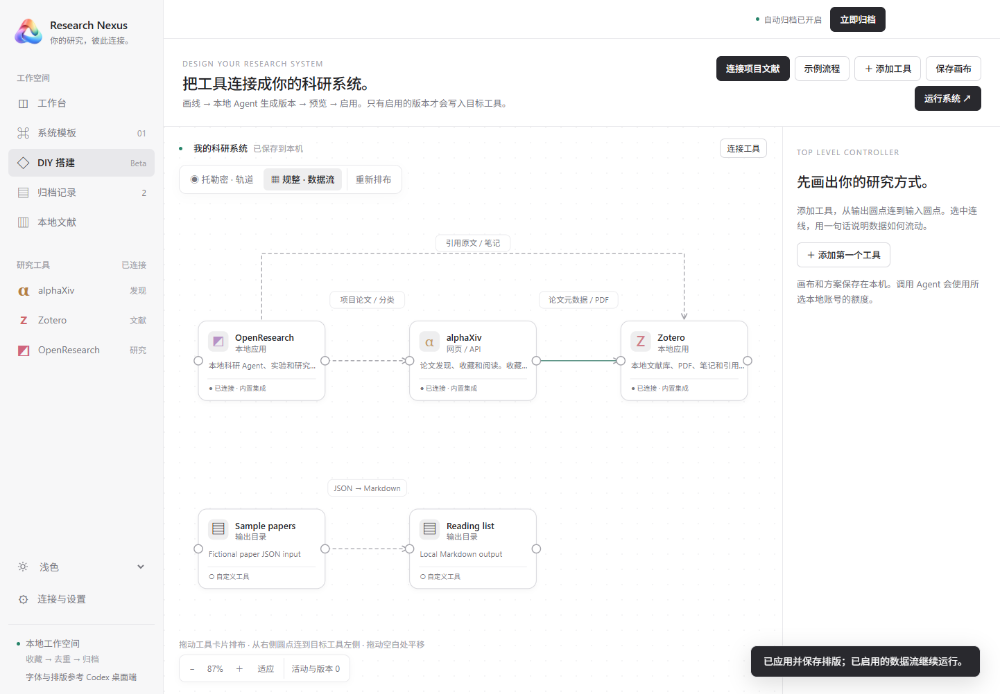

# DIY 科研系统（Beta）

[English](DIY.md)

当前源码版已开放 DIY 设计器。原 System Template 01 继续独立使用。Agent 生成的是 RN 支持的声明式方案，RN 按版本执行，不直接运行生成的任意程序。

1. 打开左侧 **DIY 搭建**，添加网页、API 服务、本地应用或输出目录。从源工具的输出圆点拖到目标工具的输入圆点，写清楚数据用途。
2. 登记服务的 API 地址及凭据环境变量名。方案内不填写密钥；已配置的 alphaXiv / Zotero Key 继续由 RN 的本机凭据库提供。
3. 选择已安装并登录的 Codex CLI / Claude Code，生成版本。检查步骤和缺失配置，完成样例预览，再启用该版本。
4. 手动运行连线或整张已启用的图，也可选择每小时 / 每天检查。修改源、目标、用途、样例或项目范围会使旧启用失效，需重新生成和测试。
5. 失败记录可交给 Agent 生成修订版。修订版仍须测试和启用；不会自动替换正在使用的版本。旧版本与当前连线约定一致时可回退。

## OpenResearch 项目文献流

点击 **连接项目文献**，选择项目、数量上限和研究分类关键词，创建两条草稿连线：

- **OpenResearch → alphaXiv**：建立项目专属文件夹和研究分类子文件夹，收藏已识别的 arXiv 论文。
- **OpenResearch → Zotero**：建立项目分类及子分类，保存论文、原始引用上下文、对话和消息出处、引用标签；可关联同步目录 PDF。

先点击“只读预览真实项目”，再分别生成、测试、启用并运行两条连线。alphaXiv 当前的官方 MCP 支持收藏和文件夹写入，笔记和标注只有读取能力，因此引用正文笔记保存到 Zotero，不使用公开评论或未公开网页接口代替私有笔记。

读取范围为所选项目中非生成状态对话的当前分支。忙碌对话延后处理；历史导入消息可能没有完成时间，会保留已有正文和未知完成状态。不会导出思考过程、工具输入、未完成工具结果或废弃分支。可选包含已完成的工具输出，此类来源明确标为“检索发现”。

识别明确的 arXiv / DOI 引用；仅提到标题而缺少稳定标识的内容不会猜测归档。DOI 论文通过 Crossref 核实元数据后可进入 Zotero。可选择本地关键词规则或 Codex / Claude 语义分类。语义分类需明确授权将所选项目的引用上下文发送给已登录的模型服务，授权绑定提供商与项目集合；固定名单更换项目或提供商需重新授权；下文的未来项目模式使用单独授权。返回分类必须通过类别及引用编号核对，并跨连线、跨重启缓存，无法判断时归入“待分类”。方案生成使用用途说明与样例；生成和分类调用会在本次进程中关闭 shell、连接器、插件、记忆及子 Agent 功能。

每条笔记保留准确的上下文片段、项目、对话、消息及正文片段编号、时间、来源链接和稳定回执。笔记会说明这是研究对话上下文，不代表已核实的论文逐字原文。同一出处重复运行复用笔记编号，保留人工补充；同一论文在另一处引用时可新增一条出处笔记。已有元数据、其他分类、标签和笔记均保留。分类变更在同一笔记中通过版本检查追加分类记录，保留原文及人工补充。疑似重复或尚未同步的本地文献需要先核对。

只有在对应链接 PDF 中唯一找到的逐字引文才创建高亮，坐标由 PDFium 从实际原文取得。无法定位或有多处匹配时不生成高亮。扫描版 PDF 需要独立 OCR。Zotero 元数据同步及 Drive 文件同步由各自客户端完成。

## 自动接入未来项目

在“连接项目文献”中开启 **自动接入当前及未来所有 OpenResearch 项目**，选择“每天”，使用语义分类时明确勾选未来项目内容授权。首次变更模式仍需为两条连线生成、测试和启用版本。以后新建项目属于已授权的数据范围，通过本地 `/api/events` SSE 的 `project.updated` 事件即时发现并建立 alphaXiv / Zotero 独立空目录，无须再次生成方案。项目有了明确论文引用后，下一次每日检查会归档论文和出处笔记。

未来项目授权绑定本机 OpenResearch 服务地址及模型提供商；固定项目授权不能升级为未来项目授权，Codex 授权不能用于 Claude。变更地址或提供商需重新确认。暂停某条连线会停止该目标的自动接入；暂停两条连线会停止全部发现写入。项目删除不会删除已经归档的目录、笔记或附件；项目改名保留原目录名称和身份。

自动模式按目标分别保存完成回执，只处理新增或尚未完成的引用，分类结果继续复用缓存。每批上限保持生效，超出部分在后续每日批次继续处理；暂时失败的旧引用不会一直排在新增引用前面。只读预览仍展示范围内的样例，不会把引用标记为完成。启动和断线重连时补查遗漏项目；当前任务忙碌时排队，失败时退避重试。空闲时不定时查询项目列表。DIY 页显示事件流连接状态、排队状态、错误及“检查新项目”按钮。RN 需持续运行、电脑保持唤醒，OpenResearch 本地服务需可访问。

## 画布排版模板

在 DIY 画布左上角选择 **托勒密 · 轨道** 或 **规整 · 数据流**。轨道视图以 RN 为视觉中心，工具沿椭圆轨道排列，数据流采用弧线；这是科研工具关系图，不是天体轨道计算。规整视图按数据方向分层排列工具，使用直角连线；跨层和反向连接从卡片外侧绕行。断开的子系统单独排列。

切换模板会重新排布并保存卡片位置；手动拖动后可点“重新排布”恢复当前模板。布局与业务执行合同分离，因此切换视图不会暂停已启用版本，也无需重新调用 Agent。两种视图都支持深色、浅色和跟随系统。新增工具仍可拖动并连接；排版不会删除节点或连线。

以下截图使用隔离的虚构数据与模拟服务，不包含真实项目或账号。

## 当前边界

- 固定名单模式每次处理前 N 篇；自动模式按增量完成回执在后续批次继续。单批最多 200 篇不同论文，预览和日志显示待处理数量。
- 自动检查需要 RN 保持运行且电脑唤醒；两条连线分别启用、暂停和运行。
- Zotero Key 需读写及笔记权限；桌面版需启用本地 API 以检查未同步的重复文献。Drive 目录不可用时保留已保存的引用笔记并报告 PDF 待处理。
- 自定义 HTTP 方案只能使用连线两端登记的地址和凭据；缺少可用接口时必须标为 `needs_setup`，不能把样例输出当作已经完成的真实接入。
- 项目名称、对话、构建请求、凭据和回执保存在被忽略的 `data/`，不能作为系统模板提交或分享。

## 验证

`npm test`、`npm run test:desktop` 和 `npm run test:systems` 使用隔离样例。引用测试覆盖分支、出处、子目录、重复写入、中断恢复、本地重复防护和 PDF 坐标。`--verify-diy-live` 是显式启用的真实写入测试，通过私有 `data/research-test-scope.json` 选择项目，在真正的 RN 设计器中调用本地 Agent、归档并重复核对。只有明确选择了项目、账号和写入范围时才使用该参数。
